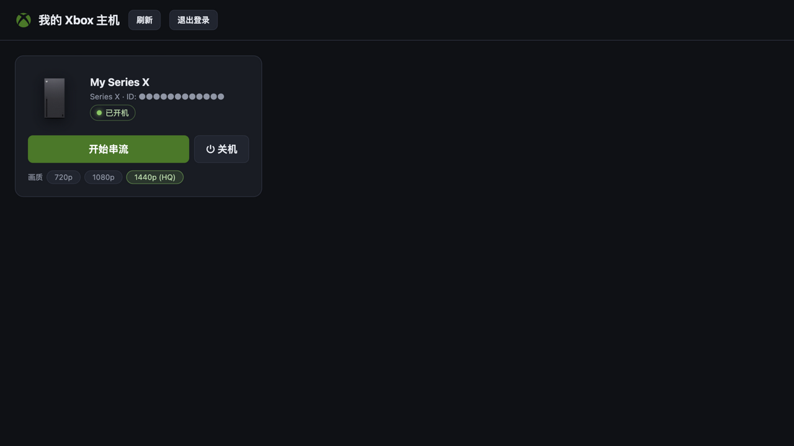

# XboxWebRemote — Xbox 网页串流（浏览器 Remote Play）

在浏览器里远程串流/控制你自己的 Xbox 主机（xHome Remote Play）。零安装依赖、双击即用；局域网/IPv6 自动直连，延迟可低至 2ms。**跨平台：macOS / Windows / Linux**。

> **🤖 AI 生成声明 / AI-generated**
> 本项目由 **ZCode AI 编码代理（基于智谱 Z.ai 的 GLM 大模型）** 应用户需求编写，包括全部服务端、前端与协议实现。
> This project was developed by the **ZCode AI coding agent (powered by GLM, trained by Z.ai)** at a user's request — all server, frontend and protocol code included.



## 功能

- **浏览器内串流**：WebRTC 播放，无需安装 Xbox App / 客户端
- **直连优先**：局域网 host 直连、IPv6 直连、Teredo 转换；微软服务器只参与信令，画面不经中转（统计面板实时显示链路类型 / 码率 / RTT / 丢包）
- **画质档位**：720p / 1080p / **1440p (HQ)**（需主机系统支持；分辨率协商机制与手机端 XStreaming 相同）
- **远程开关机**：主页一键 WakeUp / TurnOff（走微软 xccs 远程管理通道）
- **蓝牙/USB 手柄**：即插即用（支持震动）+ 键盘按键映射
- **直播模式**：弹出干净的直播窗口给抖音直播伴侣等「窗口捕获」；音频自动接管
- **直播源**：把串流画面变成 `HTTP-FLV`（推流给 OBS/直播助手，按硬件自动选择编码器并锁定 8Mbps）与 **HLS m3u8**（局域网设备直接观看）两种拉流地址，一键复制

## 快速开始（macOS）

1. 双击 **双击启动.command**（启动本地服务 + 打开浏览器 `http://127.0.0.1:8977`）
2. 首次点「登录微软账号」，按提示登录；登录后浏览器弹出「打开 Xbox网页串流？」时点**打开**（由仓库内的 `XboxLoginHelper.app` 自动完成回调）
3. 主机列表里点「开始串流」，开玩

## 快速开始（Windows）

1. 安装 [Python 3.9+](https://www.python.org/downloads/)（勾选 "Add to PATH"），然后 `pip install cryptography`
2. 下载 [ffmpeg.exe](https://github.com/eugeneware/ffmpeg-static/releases/latest/download/ffmpeg-win64-gpl.exe) 放入 `bin/` 文件夹（仅「直播源」功能需要）
3. 双击 **启动串流-windows.bat**：会自动安装依赖、**注册 `ms-xal://` 登录回调协议**（等效 macOS 的登录助手）、启动服务并打开浏览器
4. 登录流程与 macOS 相同（登录后弹窗点「打开」，由协议处理器自动完成）

**Linux**：`python3 server.py` 即可（直播源的编码器会自动探测 VideoToolbox/NVENC/QSV/AMF，都没有则回退 libx264 veryfast）。

### ffmpeg 下载（仅「直播源」功能需要）

仓库不含大体积的 ffmpeg 二进制，按平台下载放入 `bin/` 文件夹（Windows 命名为 `ffmpeg.exe`）：

- **macOS (arm64)**：`ffmpeg-darwin-arm64`，来自 [ffmpeg-static releases](https://github.com/eugeneware/ffmpeg-static/releases/latest)
- **Windows (x64)**：`ffmpeg-win64-gpl.exe`，下载后重命名为 `ffmpeg.exe`
- Linux 发行版直接 `apt install ffmpeg` / `apk add ffmpeg` 即可

macOS 一行命令：`mkdir -p bin && curl -L -o bin/ffmpeg https://github.com/eugeneware/ffmpeg-static/releases/latest/download/ffmpeg-darwin-arm64 && chmod +x bin/ffmpeg`

## 工作原理

```
浏览器 (WebRTC 播放/输入, 硬解) ←—— P2P 媒体流 ——→ Xbox 主机
   │  信令/登录/开关机 (小 HTTP 请求)
   ▼
本地 server.py (纯 Python 标准库): XAL/SISU 登录(ProofOfPossession 签名)
   → XSTS → xHome 网关代理; xccs 远程电源; HTTP-FLV/HLS 直播源(ffmpeg remux)
```

- 串流会话必须携带主机握手令牌（lpt，`PURPOSE_XBOX_CLOUD_CONSOLE_TRANSFER_TOKEN`），否则主机会在约 5 分钟后断开；该令牌只有 XAL 系（Xbox 手机 App 同款）授权链能拿到，本项目完整实现了它
- 详细协议结论与踩坑记录见源码注释

## 目录结构

```
双击启动.command        macOS 启动器
启动串流-windows.bat    Windows 启动器 (自动装依赖 + 注册协议)
server.py              本地服务: 静态托管 + XAL 登录 + 网关代理 + 电源 + 直播源
www/index.html         网页 App (串流/主机列表/画质/统计/直播模式/直播源)
www/live.html          直播模式独立窗口
www/assets/            Xbox 标志与主机产品图 (来自 XStreaming)
XboxLoginHelper.app    macOS 的 ms-xal:// 协议回调助手 (Swift, 源码在 helper-src/)
helper-src/            助手源码与构建说明
```

## 致谢 / Credits

本项目的协议实现大量参考了以下优秀的开源项目（感谢 reverse engineering 社区）：

| 项目 | 用途 | 许可 |
|---|---|---|
| [unknownskl/xbox-xcloud-player](https://github.com/unknownskl/xbox-xcloud-player) | 播放器内核（`www/lib/xCloudPlayer.min.js` 为其 npm 构建产物） | MIT |
| [unknownskl/xal-node](https://github.com/unknownskl/xal-node) | XAL/SISU 鉴权协议参考（Python 移植） | MIT |
| [Geocld/XStreaming](https://github.com/Geocld/XStreaming) | lpt 交换、xccs 电源命令、分辨率协商机制；主机产品图与 Xbox 标志 | MIT |
| [OpenXbox/xbox-smartglass-core-python](https://github.com/OpenXbox/xbox-smartglass-core-python) | 早期电源协议调研参考 | GPL-3.0 |

## 免责声明

- 本工具仅用于串流**你自己的**主机与账号，与官方 Remote Play 功能等同；请遵守微软服务条款
- 本项目与 Microsoft 无关；Xbox 及相关标志为 Microsoft 集团商标
- 登录令牌保存在本地 `tokens.json`（已被 .gitignore 排除），请勿分享
- 串流/直播自己的游戏内容时，请注意各直播平台与游戏发行商的版权政策

## License

[MIT](LICENSE)（第三方组件见 LICENSE 末尾说明）
